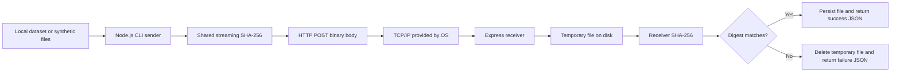

# Biometric Network — dataset integrity and evaluation

This module completes the dataset-integrity/evaluation workflow for the Node.js + Express biometric file-transfer project. It adds a shared streaming SHA-256 utility, a privacy-preserving dataset inventory, sequential/limited-parallel benchmark tooling, automated tests, and the Wireshark/report guidance.

## Safety and data handling

- Keep real biometric images and videos in your own local `dataset/` directory. Do not commit them, even to a private repository.
- The scanner prints aggregate counts, extensions and byte totals only. It does not print directory names or filenames.
- The benchmark sends generated names such as `capture-000001.bin` and does not put original local filenames into HTTP headers or its result summary.
- Use synthetic files for integration and Wireshark practice. SHA-256 checks byte integrity against the sender's claimed digest; it does not authenticate the sender. HTTP does not encrypt the payload.
- Each data owner must run any real-data evaluation locally against only the data they are authorised to access.

## Install and configure

From the project root:

```bash
npm install
cp .env.example .env
```

The existing `.env.example` contains `DATASET_DIR`, `SERVER_URL`, `HOST`, `PORT`, `UPLOAD_DIR` and `MAX_FILE_SIZE`. Keep `.env` local; it is ignored by Git. The default upload limit is 500 MiB.

## Dataset inventory

```bash
node experiments/scanDataset.js ./dataset
```

Machine-readable JSON:

```bash
node experiments/scanDataset.js ./dataset --json
```

Save only the aggregate inventory:

```bash
node experiments/scanDataset.js ./dataset --output=results/dataset-summary.json
```

The scanner walks directories recursively, does not follow symbolic links, counts regular files by lowercase extension, and reports total files and bytes. A suggested local organisation is `dataset/<hand>/<region>/<phone>/<distance>/`; the scanner audits file totals and extensions but does not validate the meaning of folder labels. It does not inspect image/video contents.

## Start the receiver and transfer synthetic samples

Terminal 1:

```bash
npm start
```

Terminal 2:

```bash
node sender/client.js sender/sample.txt
node sender/batch.js ./path/to/synthetic-folder
node sender/batch-parallel.js ./path/to/synthetic-folder
```

All senders use the shared `src/utils/hash.js` helper and the `SERVER_URL` environment variable. `SERVER_URL` is the receiver base URL, for example `http://127.0.0.1:5000`. The receiver endpoint is `/api/biometric/upload`.

For a local two-terminal test, keep `HOST=127.0.0.1` and `SERVER_URL=http://127.0.0.1:5000`. For an approved lab-LAN test, set the receiver to `HOST=0.0.0.0`, and set the sender's `SERVER_URL` to the receiver's LAN address. Do not expose the receiver to an untrusted network.

## Benchmark sequential vs limited concurrency

Start the receiver, then run:

```bash
node experiments/benchmark.js ./synthetic-dataset --mode both --concurrency=2
```

Or benchmark one mode:

```bash
node experiments/benchmark.js ./synthetic-dataset --mode sequential
node experiments/benchmark.js ./synthetic-dataset --mode parallel --concurrency=4
```

The URL comes from `SERVER_URL` or defaults to `http://127.0.0.1:5000`. Override it with `--url=http://127.0.0.1:5000`. Save a sanitised aggregate report with:

```bash
node experiments/benchmark.js ./synthetic-dataset --mode both --concurrency=2 --output=results/benchmark-summary.json
```

The output includes attempted/successful/failed counts, total bytes, success rate, elapsed time and throughput in decimal MB/s and Mbps. It contains per-file byte/time/status records indexed by number but no source filenames or directory paths.

**Timing definition:** wall-clock time starts before the first per-file SHA-256 calculation and ends after all receiver responses arrive. Throughput is total input bytes divided by this elapsed time. Hashing cost is therefore included. The `networkScope` field identifies localhost/loopback versus a remote host; confirm separately whether a remote test was actually conducted over the intended LAN/Wi-Fi.

The `both` mode runs sequential first and then limited-parallel. For defensible measurements, repeat several times under the same conditions and report the individual runs or a clearly described average. Do not treat a single localhost result as Wi-Fi/LAN performance.

## Tests

```bash
npm test
```

The test suite covers the new streaming hash helper, aggregate dataset inventory, filename privacy in the scanner/benchmark report, synthetic end-to-end benchmark success/failure accounting, and invalid dataset paths. The existing receiver tests remain part of `npm test`.

## Wireshark and report

- Follow [`docs/WIRESHARK.md`](docs/WIRESHARK.md) for the `lo` interface and `tcp.port == 5000` filter, plus LAN cautions.
- Fill [`docs/REPORT_TEMPLATE.md`](docs/REPORT_TEMPLATE.md) using measured data and your own sanitised screenshots. Do not invent numbers.

## Architecture


