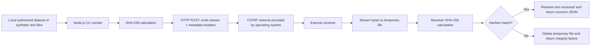

# Biometric Data Transmission Using HTTP over TCP/IP

> Complete this template with your team's actual measurements and screenshots. Do not invent results. Do not include biometric images, videos, subject names, capture filenames, raw packet payloads, or private IP addresses in the submitted report.

## 1. Objective

Describe the objective: transfer a file as raw binary data from a Node.js CLI sender to an Express receiver over HTTP/TCP, reconstruct it at the receiver, and verify byte integrity with SHA-256.

## 2. Architecture

## 3. Protocol and implementation

- Method and endpoint: `POST /api/biometric/upload`
- Content type: `application/octet-stream`
- Metadata headers: `X-File-Name` and `X-File-SHA256`
- Success response: HTTP 201 JSON with byte count and integrity status
- Describe how the receiver validates metadata, enforces its size limit, streams bytes, and avoids filename collisions.

SHA-256 confirms that received bytes match the digest claimed by the sender; it does not authenticate the sender. HTTP does not encrypt the payload.

## 4. Test procedure and correctness

Record the Node.js version, machine/network setup, file sizes, and commands used. Summarise valid transfer, altered/wrong hash, malformed header, unsafe filename, empty file, too-large file, interrupted upload, and concurrent-upload tests. Attach screenshots/logs with private data removed.

## 5. Performance results

State whether each run used localhost/loopback or a real Wi-Fi/Ethernet LAN. Include the number of files and total bytes.

| Mode | Concurrency | Files attempted | Successful | Failed | Duration (s) | Throughput (MB/s) | Success rate (%) |
|---|---:|---:|---:|---:|---:|---:|---:|
| Sequential | 1 | [measure] | [measure] | [measure] | [measure] | [measure] | [measure] |
| Limited parallel | [measure] | [measure] | [measure] | [measure] | [measure] | [measure] | [measure] |

This project's benchmark throughput is total input bytes divided by measured wall-clock time; the measured interval includes per-file SHA-256 calculation and upload/receiver response. MB/s uses decimal megabytes (1 MB = 1,000,000 bytes). Mbps = MB/s × 8.

## 6. Wireshark analysis

State the interface and filter (for localhost: `lo`, `tcp.port == 5000`). Describe only packets/events visible in your capture: handshake, HTTP request/response, acknowledgements, segments, and any retransmissions. Add the sanitised screenshots.

## 7. Conclusion and limitations

Summarise observed integrity and performance. State the test environment and limitations. Do not describe localhost results as LAN performance, and do not claim that SHA-256 authenticates the sender or that plain HTTP provides confidentiality.
