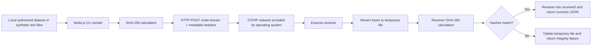

# Biometric Data Transmission Using HTTP over TCP/IP

> Complete this template with your team's actual measurements and screenshots. Do not invent results. Do not include biometric images, videos, subject names, capture filenames, raw packet payloads, or private IP addresses in the submitted report.

## 1. Objective

Describe the objective: transfer a file as raw binary data from a Node.js CLI sender to an Express receiver over HTTP/TCP, reconstruct it at the receiver, and verify byte integrity with SHA-256.

## 2. Architecture

## 3. Protocol and implementation

- Method and endpoint: `POST /api/biometric/upload`
- Content type: `application/octet-stream`
- Metadata headers: `X-File-Name` and `X-File-SHA256`
- Success response: HTTP 201 JSON with byte count and integrity status
- Describe how the receiver validates metadata, enforces its size limit, streams bytes, and avoids filename collisions.

SHA-256 confirms that received bytes match the digest claimed by the sender; it does not authenticate the sender. HTTP does not encrypt the payload.

## 4. Test procedure and correctness

Record the Node.js version, machine/network setup, file sizes, and commands used. Summarise valid transfer, altered/wrong hash, malformed header, unsafe filename, empty file, too-large file, interrupted upload, and concurrent-upload tests. Attach screenshots/logs with private data removed.

## 5. Performance results

The following local evaluation used a deterministic sample of 20 files from the already-captured dataset: 10 JPG images and 10 MP4 videos, totalling 104,049,594 bytes. Each measurement was repeated three times; the table reports the median. The receiver and sender ran on the same computer over localhost/loopback, with four workers in limited-parallel mode.

Environment: Node.js v26.13.0, Linux 7.2.14-arch1-1, 13th Gen Intel Core i5-13420H (12 logical CPUs). Receiver URL: `http://127.0.0.1:5000`. Command pattern: `node experiments/benchmark.js <sample-directory> --mode both --concurrency=4 --url=http://127.0.0.1:5000`.

| Mode | Concurrency | Files attempted | Successful | Failed | Median duration (s) | Median throughput (MB/s) | Success rate (%) |
|---|---:|---:|---:|---:|---:|---:|---:|
| Sequential | 1 | 20 | 20 | 0 | 0.256 | 406.677 | 100 |
| Limited parallel | 4 | 20 | 20 | 0 | 0.132 | 790.307 | 100 |

Individual throughput readings across the three repetitions were 357.950, 431.332 and 406.677 MB/s for sequential mode, and 817.275, 790.307 and 758.615 MB/s for limited-parallel mode. The median parallel throughput was about 1.94 times the sequential result for this sample. Sanitised per-run summaries are kept locally in the ignored `results/raw/` directory.

This project's benchmark throughput is total input bytes divided by measured wall-clock time; the measured interval includes per-file SHA-256 calculation and upload/receiver response. MB/s uses decimal megabytes (1 MB = 1,000,000 bytes). Mbps = MB/s × 8.

These are localhost results, not Wi-Fi/Ethernet LAN results. They reflect this machine, its filesystem and loopback networking; run the same experiment across the intended LAN before making claims about LAN throughput.

## 6. Wireshark analysis

State the interface and filter (for localhost: `lo`, `tcp.port == 5000`). Describe only packets/events visible in your capture: handshake, HTTP request/response, acknowledgements, segments, and any retransmissions. Add the sanitised screenshots.

## 7. Conclusion and limitations

Summarise observed integrity and performance. State the test environment and limitations. Do not describe localhost results as LAN performance, and do not claim that SHA-256 authenticates the sender or that plain HTTP provides confidentiality.
